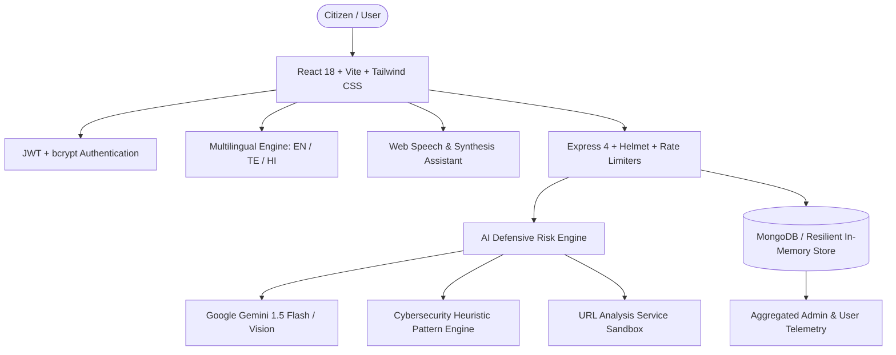

# 🛡️ ScamShield AI
### AI-Powered Digital Fraud & Scam Detection Platform
> *"Think Before You Click." — AI-powered protection against digital scams, phishing messages, malicious URLs, and payment fraud.*

[](https://opensource.org/licenses/MIT)
[](https://nodejs.org/)
[](https://reactjs.org/)
[](https://www.typescriptlang.org/)
[](https://tailwindcss.com/)
[](#security-principles)

---

## 1. Project Overview & Problem Statement

Digital financial frauds, phishing campaigns, fake recruitment drives, and UPI collect deceptions cause billions of dollars in losses annually. Ordinary citizens, students, and senior citizens frequently fall victim to sophisticated social engineering, urgent ultimatums, and lookalike web domains.

**ScamShield AI** is a defensive cybersecurity risk-analysis platform. It assists users in evaluating suspicious digital content **before** they compromise passwords, surrender OTPs, or transfer money. 

Instead of binary "scam / not scam" answers, ScamShield AI delivers an **explainable risk score (0–100)** categorized into:
- 🟢 **SAFE** (0–19)
- 🔵 **LOW RISK** (20–39)
- 🟡 **MEDIUM RISK** (40–59)
- 🟠 **HIGH RISK** (60–79)
- 🔴 **CRITICAL RISK** (80–100)

accompanied by explicit red flags, extracted evidence, and actionable safety checklists.

---

## 2. Key Features

1. **Universal Threat Scanner**:
   - 💬 **SMS & Chat Scanner**: Analyzes urgency tactics, panic triggers, bank impersonations, and credential demands.
   - 🌐 **Malicious URL Inspector**: Evaluates raw IP hostnames, punycode/homograph attacks, suspicious TLDs (`.xyz`, `.top`, `.click`), excessive subdomains, and redirect indicators in a safe, non-executing sandbox.
   - 📸 **Vision Screenshot Scanner**: Upload screenshots (up to 10 MB) of suspicious conversations or payment gateways for deep AI visual inspection.
   - 💼 **Job & Internship Fraud Detector**: Detects upfront training fees, Telegram task pyramids, and YouTube video-liking traps.
   - 💳 **UPI & Payment Scam Analyzer**: Identifies fraudulent collect requests disguised as refunds or cashback lures.
2. **Explainable AI (XAI)**:
   - Detailed *"Why We Flagged This"* breakdowns highlighting specific psychological and technical indicators.
   - Separate verification flags when signals require legitimate manual follow-up.
3. **Interactive Protective Checklist**:
   - Step-by-step safety actions with real-time interactive checkboxes.
4. **Live Presentation Demo Mode**:
   - One-click launcher with 6 real-world scenarios (SBI KYC alert, YouTube task scam, UPI refund fraud, KBC lottery, Phishing URL, Safe bank credit receipt) enabling instant 10-second workshop demonstrations.
5. **AI Voice Assistant**:
   - Web Speech Recognition (speech-to-text) to dictate questions like *"Is this message a scam?"* and Speech Synthesis (text-to-speech) to vocalize risk assessments.
6. **Scam Academy**:
   - 11 educational guides covering Phishing, UPI collect fraud, OTP forwarding, Job scams, Crypto Ponzi schemes, Fake customer support, KYC ultimatums, Lottery traps, AI voice clones, Quishing (QR code tampering), and Matrimonial scams.
7. **Crowdsourced Scam Reporting**:
   - Community submission system with SHA-256 privacy hashing to report numbers, URLs, and UPI IDs without leaking citizen PII.
8. **Administrative Intelligence Console**:
   - Aggregated, anonymized telemetry on scans volume, risk distribution, and top threats.
9. **Multilingual Cybersecurity Alerts**:
   - Full support for **English**, **Telugu (తెలుగు)**, and **Hindi (हिन्दी)** with prominent golden-rule warnings.

---

## 3. Architecture & Tech Stack



### Technology Highlights
- **Frontend**: React 18, TypeScript, Vite, Tailwind CSS, Lucide Icons, Recharts, Canvas Confetti.
- **Backend**: Node.js, Express 4, TypeScript, Helmet, CORS, Express-Rate-Limit, Multer.
- **Database**: MongoDB via Mongoose with an automatic resilient in-memory fallback store for instant local demos without local database configuration.
- **AI Service**: Google Gemini API integration with modular provider abstraction and an internal regex heuristic cybersecurity engine.

---

## 4. Security Principles & Safety Charter

- 🛡️ **Defensive Product Only**: Architecturally designed to detect threats. Never generates malicious phishing pages, credential-harvesting code, or fraud instructions.
- 🔒 **Zero-Credential Retention**: ScamShield AI will **NEVER** ask for OTPs, UPI PINs, passwords, or CVVs. All message snippets saved to user history are automatically scrubbed and redacted.
- 🌐 **Safe URL Isolation**: Analyzes URL syntactic structure and domain reputation markers without initiating dangerous outbound browser or server requests to untrusted targets.
- ⚖️ **Advisory Disclaimer**: *"This analysis is an AI-based risk assessment, not a definitive determination of fraud."*

---

## 5. API Reference

### Health & System
- `GET /api/health` — System status and defensive risk engine health check.

### Authentication
- `POST /api/auth/register` — Register a citizen account (`name`, `email`, `password`).
- `POST /api/auth/login` — Sign in and receive JWT token.
- `GET /api/auth/me` — Retrieve authenticated user profile.

### AI Risk Analysis
- `POST /api/ai/analyze-message` — Analyze SMS or chat messages for social engineering.
- `POST /api/ai/analyze-url` — Safely parse and inspect web links.
- `POST /api/ai/analyze-image` — Inspect screenshots via vision AI (multipart/form-data, max 10MB).
- `POST /api/ai/analyze-job` — Assess recruitment and internship solicitations.
- `POST /api/ai/analyze-payment` — Detect deceptive UPI collect and refund schemes.

### Scans & History
- `POST /api/scans` — Save an evaluated scan to user history.
- `GET /api/scans` — Retrieve scan records with optional filters (`scanType`, `riskLevel`).
- `GET /api/scans/:id` — Retrieve specific scan details.
- `DELETE /api/scans/:id` — Remove an item from scan history.

### Community Reports
- `POST /api/reports` — Submit suspicious phone, link, or UPI ID.
- `GET /api/reports` — Fetch community threat submissions.

### Scam Academy & Admin
- `GET /api/education` — List cybersecurity defense playbooks.
- `GET /api/education/:slug` — Read full 5-section guide.
- `GET /api/admin/statistics` — Fetch aggregated telemetry.

---

## 6. Environment Variables

Create `.env` in `server/`:

```env
PORT=5000
MONGODB_URI=mongodb://localhost:27017/scamshield
JWT_SECRET=your_secure_jwt_secret_token
CLIENT_URL=http://localhost:5173

# Optional: Google Gemini API Key for advanced LLM & Vision reasoning
# If left empty, ScamShield AI operates seamlessly via the internal heuristic engine
GEMINI_API_KEY=
```

---

## 7. Local Quickstart

### Prerequisites
- Node.js v18+ 
- npm v9+

### 1. Installation
Install dependencies across both client and server:
```bash
npm install --prefix server
npm install --prefix client
```

### 2. Build the Application
```bash
npm --prefix client run build
npm --prefix server run build
```

### 3. Run the Servers
You can launch both the full-stack server (port 5000) and the Vite hot-reloading dev server (port 5173):

```bash
# Terminal 1: Backend Server (Port 5000)
npm --prefix server start

# Terminal 2: Frontend Dev Server (Port 5173)
npm --prefix client run dev
```

Open your browser to:
- **Frontend**: [http://localhost:5173](http://localhost:5173)
- **Full-Stack Application / API**: [http://localhost:5000](http://localhost:5000)

---

## 8. Test Credentials & Demo Presentation

For instant evaluations, college hackathons, or workshops:
- **Citizen Account**: `user@scamshield.ai` / `User@12345` (or click **Demo Citizen**)
- **Admin Account**: `admin@scamshield.ai` / `Admin@12345` (or click **Demo Admin**)
- **Live Demo Scenarios**: Click the golden **"Demo Mode"** button in the navigation bar to test 6 real-world threat scenarios in under 10 seconds.

---

## 9. Emergency Helplines (India)

- 🚨 **National Cyber Crime Helpline**: **1930** (Dial immediately if money was transferred)
- 🌐 **National Cyber Crime Reporting Portal**: [cybercrime.gov.in](https://cybercrime.gov.in)
- 📱 **Chakshu Fraud Communication Facility**: [sancharsaathi.gov.in](https://sancharsaathi.gov.in)
- 📈 **SEBI SCORES Portal**: [scores.sebi.gov.in](https://scores.sebi.gov.in)

---

## 10. License
Distributed under the MIT License. Built defensively for citizen cybersecurity awareness.

# Sheild-ai

